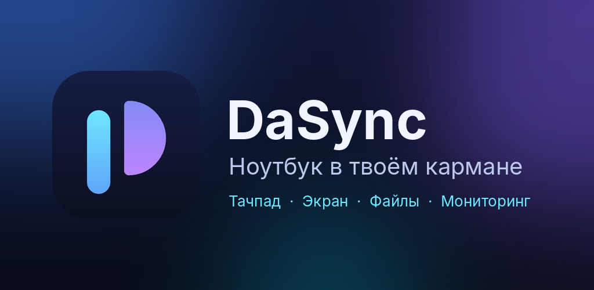
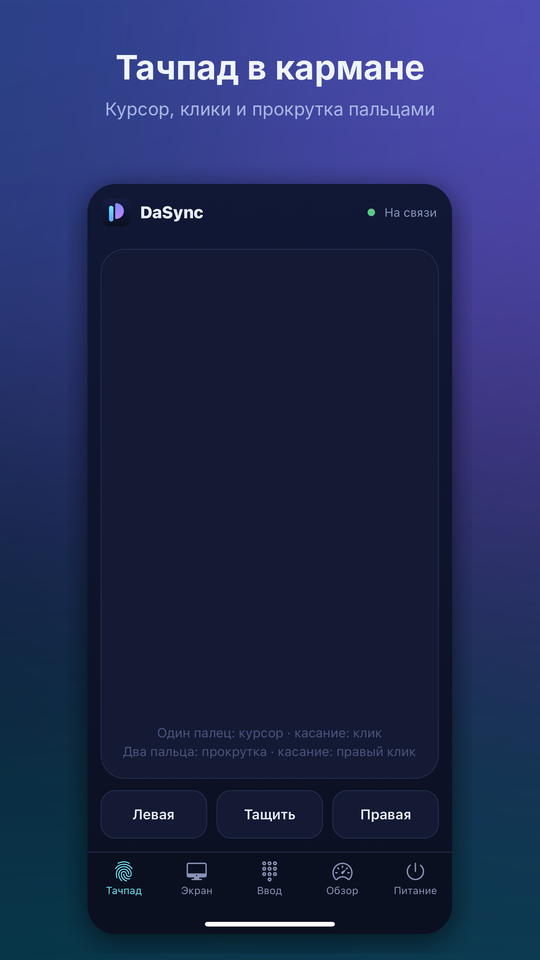
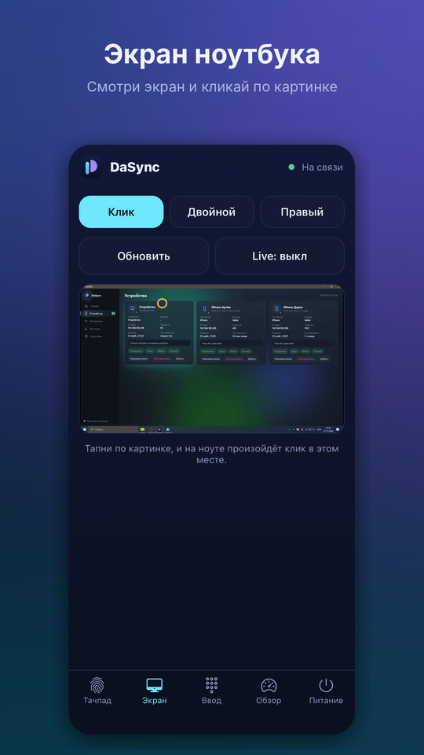
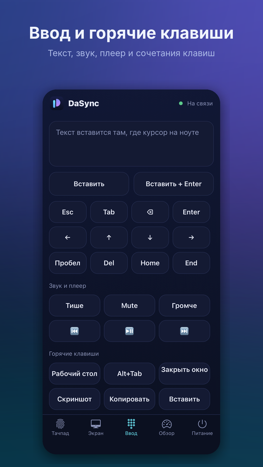
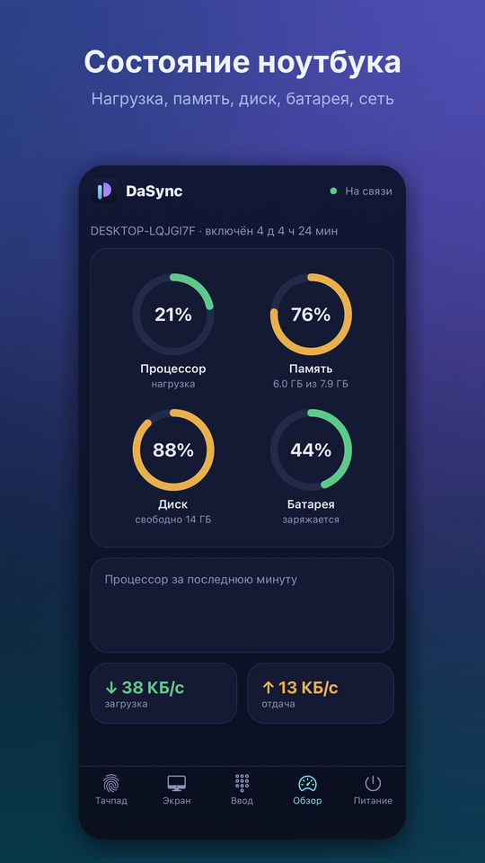

  

<h1 align="center">DaSync</h1>

  <b>Ноутбук в твоём кармане.</b> 
  Управляй ноутбуком с телефона по домашней Wi-Fi: тачпад, экран, клавиатура, файлы и мониторинг. 
  Без аккаунтов и облака.

  
  
  

  

  

## Как это выглядит

<table>
  <tr>
    <td align="center"></td>
    <td align="center"></td>
    <td align="center"></td>
    <td align="center"></td>
  </tr>
  <tr>
    <td align="center">Тачпад</td>
    <td align="center">Экран ноутбука</td>
    <td align="center">Ввод и клавиши</td>
    <td align="center">Состояние</td>
  </tr>
</table>

## Что умеет

- **Тачпад.** Курсор, клики, правый клик, прокрутка двумя пальцами, перетаскивание.
- **Экран ноутбука.** Смотри картинку и кликай прямо по ней, есть режим Live.
- **Клавиатура.** Ввод текста (русский тоже), стрелки, горячие клавиши, звук и плеер.
- **Файлы и буфер обмена.** Отправляй фото, видео и документы на ноутбук и забирай файлы обратно.
- **Мониторинг.** Нагрузка процессора, память, диск, батарея, сеть, история за неделю.
- **Питание.** Заблокировать, усыпить, выключить сразу или по таймеру.

## Как начать

1. **Поставь программу на ноутбук с Windows:** [DaSync-Setup.exe](https://github.com/Syl1g/DaSync/releases/latest/download/DaSync-Setup.exe). Она сама откроет окно с QR-кодом.
2. **Поставь приложение на телефон:** [Android (APK)](https://github.com/Syl1g/DaSync/releases/latest/download/DaSync.apk). На iPhone пока работает версия в Safari: наведи камеру на QR, а версия для App Store и TestFlight готовится.
3. **Наведи камеру на QR** и подтверди подключение в окне DaSync на ноутбуке. Вводить пароли не нужно.

Хочешь сначала посмотреть? В приложении есть демо-режим: он показывает все экраны без ноутбука.

## Безопасность

- QR-код одноразовый и действует две минуты.
- Каждое новое устройство нужно подтвердить на ноутбуке, и у каждого свои права (питание по умолчанию выключено).
- Каждый запрос подписан ключом устройства.
- Данные никуда не отправляются: всё идёт напрямую между телефоном и ноутбуком по твоей сети. Подробнее в [политике конфиденциальности](https://syl1g.github.io/DaSync/privacy.html).

> **Важно:** связь внутри домашней сети пока не шифруется. Не включай DaSync в публичных Wi-Fi (кафе, вокзалы): для этого есть пауза в меню значка у часов.

## Частые вопросы

Windows пишет «Система Windows защитила ваш компьютер»

Программа новая и пока без цифровой подписи, поэтому Windows осторожничает. Нажми «Подробнее», затем «Выполнить в любом случае».

Телефон не видит ноутбук

Проверь, что оба устройства в одной Wi-Fi и что Windows считает эту сеть «Частной» (Параметры, Сеть и Интернет, Wi-Fi, свойства сети). Если у ноутбука сменился адрес, в приложении есть кнопка «Найти в сети».

Нужен ли аккаунт или интернет?

Нет. Телефон и ноутбук общаются напрямую по твоей Wi-Fi.

## Статус

Ранняя версия. Windows и Android работают, iPhone пока через Safari. Скоро: Google Play, TestFlight, заметки и история нагрузки в приложении, шифрование трафика.
Нашёл ошибку или есть идея? [Напиши в Issues](https://github.com/Syl1g/DaSync/issues).

## Лицензия

DaSync свободная программа: исходный код открыт и распространяется по лицензии [GNU GPL v3 или новее](LICENSE). Можно пользоваться, изучать, менять и делиться, но изменённые версии нужно выпускать на тех же условиях и с исходным кодом. Название «DaSync» и логотип в лицензию не входят. Сторонние компоненты: [THIRD_PARTY_NOTICES.md](THIRD_PARTY_NOTICES.md).

---

Для разработчиков: [как собрать и выпустить версию](docs/DEVELOPING.md) · [политика конфиденциальности](https://syl1g.github.io/DaSync/privacy.html)
